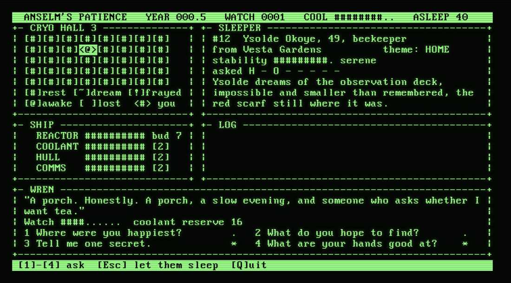

# Cold Storage (COLDSTOR)

A sleeper-ship game for CP/M, written in **Z80 assembly** for **CP/M 2.2**. 4 MHz, 80x24,
VT100 / VT52 / ADM-3A, plain ASCII. No hurry, no game over.



You are **WREN**, the last of the ship's minds still awake: a backup process on a machine the size of
a breadbin. The colony ship **ANSELM'S PATIENCE** is 140 years from anywhere. Forty sleepers lie in
Hall 3, the reactor is tired, the coolant is tired, and the hum in the walls has begun to sound like
a question. You may wake one sleeper at a time and talk to them. Waking costs coolant; it also keeps
them steady. What you ask is what they dream. Nothing here can be won, and everything can be done
kindly.

- Forty sleepers, each with a name, a trade, a home and a theme, and four questions to ask.
- A ship to keep going: reactor, coolant, hull and comms, and a crew budget to spend on mending.
- Events that come and go, a log that keeps what you missed, and a Veil to cross at year 30.
- A year is a real minute; the ship goes on while you are away, and the game saves and resumes.
- Plain ASCII only, so it works on any terminal that speaks one of the three dialects.

## Playing

You need a CP/M 2.2 machine (or an emulator) with a VT100, VT52 or ADM-3A console. Take
`COLDSTOR.COM` and `COLDSTOR.DAT` from the [releases](https://github.com/cstroie/cold-storage/releases)
and copy them onto a disk (**both**, side by side), then run:

```
A>COLDSTOR          asks for your terminal the first time
A>COLDSTOR /100     VT100        /52   VT52        /ADM   ADM-3A
```

The voyage is saved in `COLDSTOR.SAV` beside the program; delete it to begin again. The words are in
`COLDSTOR.DAT`: keep it next to `COLDSTOR.COM`. About 33K of disk, and a 64K machine. It sits on the
shelf of [DigitalRerun](https://github.com/cstroie/digital-rerun), a CP/M computer in the browser:
*Games*, *Cold Storage*, *Insert*, then type `PLAY`.

### Keys

The bottom line of the screen always shows the keys that work just then.

| Key | |
|---|---|
| arrows | choose a pod |
| `W` or Enter | wake the sleeper (costs 2 of the coolant reserve) |
| `1`-`4` | ask one of the four questions (costs 1 each; `*` means not yet asked) |
| `Esc` | let them sleep again (the pod closes by itself after a while) |
| `S` | the ship: up/down choose a system, left/right (or `-` `+`) move crew |
| `M` `L` | the map; the lost |
| `A` `B` | choose in an event (any other key goes on once it is read) |
| `?` `Q` | the introduction again; quit (the voyage is saved) |

### How it goes

Every year the ship wears a little, the sleepers drift (a thin sleeper dreams of fear, a steady one of
hope), the coolant reserve refills, and usually something happens. If you do not answer an event, the
moment passes. A question asked for the first time steadies a sleeper and may change what they dream;
asked again it steadies them a little. The crew is a budget: the reactor sets it and it only wears
down, so choose which of coolant, hull and comms to keep mended. Sleepers can be lost, quietly, and
remembered; the ship always goes on.

The full player's text is in [`docs/PLAYING.txt`](docs/PLAYING.txt). I will not spoil the rest.

## Building

You need [pasmo](https://pasmo.speccy.org/) (`apt install pasmo`) and Node.js.

```
sh build.sh                  COLDSTOR.DAT and dat.inc (mkdat.js), then COLDSTOR.COM (pasmo)
PASMO=/path/to/pasmo sh build.sh
DEST=/some/disk/dir sh build.sh      also copy both files there
```

The game's words (the sleepers, their dreams and answers, the events, the log) are in `coldstor.txt`;
`mkdat.js` packs them into `COLDSTOR.DAT` and `dat.inc`, and refuses a line that does not fit. Neither
the `.COM` nor the `.DAT` is kept in git: the releases carry both.
The version is in [VERSION](VERSION), the history in [CHANGELOG.md](CHANGELOG.md).

## Source

| File | Role |
|------|------|
| `coldstor.asm` | start, main loop, key dispatch, new voyage, title, texts, state and buffers |
| `term.asm`, `clock.asm` | terminal driver and console; DigitalRerun's clock device for 100 ms ticks |
| `text.asm`, `ui.asm`, `focus.asm` | the words (loader, tokens, word wrap); boxes, header, hall, sleeper, ship and log; the focus pane per mode |
| `hall.asm`, `talk.asm`, `ship.asm`, `event.asm` | the keys of each mode and what they do |
| `voyage.asm`, `save.asm` | ticks, years, wear, drift, losses and the ending; `COLDSTOR.SAV` |
| `coldstor.txt`, `mkdat.js` | the content, and its packer |

[`DESIGN.md`](DESIGN.md) is the design document: the screen, the state, the voyage and how it was tested.

## Testing

```
ROOT=/path/to/digital-rerun node --test test/*.test.js     (build first)
```

The text tests (the packed `.DAT` is current, an overlong line is refused, every event has eight fields
and known effects) need nothing else. The game tests play the real program in the emulator of a
[DigitalRerun](https://github.com/cstroie/digital-rerun) checkout (default: a `digital-rerun` folder
next to this one): title, the hall, a wake, a question, a year, the ship, quit and resume.
`tools/screen.js` runs the program there and prints the screen.

## Licence

MIT, see [LICENSE](LICENSE). Copyright (c) 2026 Costin Stroie. Cold Storage is a separate project from
DigitalRerun: DigitalRerun only ships the built files, under this same licence, and its own licence
terms do not apply to them.
